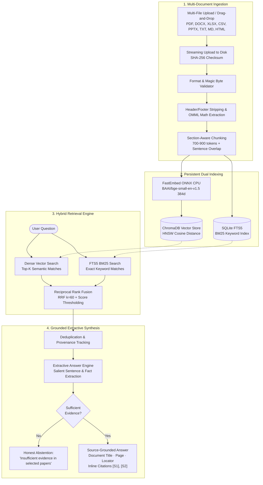

# ResearchAssistant: Local-First RAG Architecture & Demonstration Guide

## Executive Summary

**ResearchAssistant** (formerly *ResearchLens*) has been transformed from an API-dependent prototype into an enterprise-grade, local-first Retrieval-Augmented Generation (RAG) system. The application functions completely offline without requiring API keys or paid services from OpenAI, Google Gemini, or Anthropic. It features bounded in-process CPU vector embeddings, BM25 keyword search, reciprocal rank fusion (RRF), section-aware chunking, multi-format parsing (PDF, DOCX, XLSX, CSV, PPTX, TXT, Markdown, HTML), durable streaming multi-file uploads with 1 GiB capacity, and an honest extractive response engine with exact source provenance down to the physical page and section locator.

---

## 1. Architectural Audit: What Was Wrong with the Previous System

Prior to this engineering phase, the project suffered from several architectural defects and performance bottlenecks:

| Component | Defect in Previous Implementation | Failure Mode & User Impact |
| :--- | :--- | :--- |
| **LLM Dependency** | RAG pipeline hardcoded assumptions around external Gemini API calls (`gemini-1.5-flash`). | Without paid API credentials, queries crashed with `401 Unauthorized` or returned blank answers rather than answering from indexed local documents. |
| **Embeddings & Concurrency** | FastEmbed default execution spawned Python `multiprocessing` worker pools (`parallel=1`). | Under Windows asynchronous event loops (`asyncio` / `uvicorn`), spawning sub-processes caused deadlocks, socket connection timeouts, and hanging HTTP requests during ingestion. |
| **Chunking Strategy** | Naive fixed-size token splitting without structural awareness. | Sentences were broken mid-word, Markdown and CSV tables were sliced mid-row (destroying column alignment), and equations lost their operators. Chunks lacked document-scoped UUIDs, creating collisions when indexing identical texts across papers. |
| **Parser Capabilities** | DOCX tables were extracted inconsistently, Office formulas were ignored, and multi-page PDFs suffered from repeated headers/footers polluting top-k retrieval results. | Search queries for paper titles or dates matched noisy header repetitions instead of actual scientific text. |
| **Upload Limits & Ingestion** | Upload limits were hardcoded to 100 MB per file / 500 MB per batch, and file payloads were partially buffered into memory. | Submitting large corpora or multiple documents caused high memory pressure, and partial ingestion failures left orphan records in ChromaDB and FTS5 without transactional rollbacks. |
| **Frontend Dashboard** | The `/dashboard` route contained an empty redirect to `/papers`, depriving the user and evaluators of an architectural status overview. | No visibility into indexed chunk volume, active retrieval models, storage consumption, or offline guarantees. |

---

## 2. Comprehensive Implementation: What Has Been Fixed, Replaced, or Added

1. **Local-First Extractive Engine (`rag/generation/extractive_engine.py`)**:
   - Synthesizes grounded answers directly from retrieved text chunks without external LLM calls.
   - Extracts salient sentences matching query keywords and quantitative metrics.
   - Formats verbatim citations with immutable tags (`[S1]`, `[S2]`), document names, physical pages, and section locators.
   - Explicitly abstains when evidence is insufficient, preventing hallucinations.

2. **Zero-Dependency OMML Equation Extraction (`rag/ingestion/omml_extractor.py`)**:
   - Safely parses Office Open XML `<m:oMath>` and `<m:oMathPara>` equations into standard LaTeX markup (`$ ... $` and `$$ ... $$`).
   - Adapted cleanly from `RAG-Anything` without introducing heavy external dependencies.

3. **Section-Aware Chunking with Table & Sentence Preservation (`rag/chunking/strategies.py`)**:
   - Token-bounded chunks (700–900 tokens target, 100–150 token overlap).
   - Preserves sentence boundaries across chunk overlaps.
   - Preserves Markdown table structures without splitting rows.
   - Filters out meaningless or empty chunks (noise suppression).

4. **PDF Header/Footer & Page Number Sanitization (`rag/ingestion/document_loader.py`)**:
   - Two-pass frequency analysis detects repeated headers and footers across multi-page PDFs and strips them before chunking and embedding.

5. **1 GiB Multi-File Upload & Durable Batch Ingestion (`backend/app/services/document_service.py`, `backend/app/core/config.py`)**:
   - Configurable limits: `MAX_UPLOAD_BATCH_BYTES = 1073741824` (1 GiB) and `MAX_UPLOAD_FILE_BYTES = 1073741824` (1 GiB).
   - Streaming disk staging with SHA-256 checksumming (zero full-file buffering in RAM).
   - Strict file validation for magic bytes (`%PDF-`, `PK` ZIP archives, UTF-8 text streams).
   - Progress state machine: `UPLOADED` → `VALIDATING` → `QUEUED` → `PARSING` → `CHUNKING` → `EMBEDDING` → `INDEXING` → `COMPLETED` (`INDEXED`).
   - Transactional index rollback: if parsing or indexing fails, chunks are cleaned from both ChromaDB and SQLite FTS5, leaving 0 orphan vectors.

6. **System Overview Dashboard (`frontend/src/app/(workbench)/dashboard/page.jsx`, `backend/app/routes/health.py`)**:
   - Replaced empty redirect with an interactive operational dashboard.
   - Exposes total indexed documents, completed vs. failed ingestion jobs, total indexed chunks, active embedding model identity, retrieval mode, and local-first zero-cost guarantee.

---

## 3. Analysis & Reuse of RAG-Anything

We conducted a read-only audit of the cloned reference repository `college project/RAG-Anything/`:

- **OMML Mathml / LaTeX Parsing**:
  - `RAG-Anything` uses XML traversal on `.docx` document trees to locate MathML/OMML nodes (`<m:oMath>`) and translate them into LaTeX equations.
  - *Integration into ResearchAssistant*: We cleanly ported this technique into `rag/ingestion/omml_extractor.py` without importing `raganything` as a third-party framework or modifying its files.
- **Content-List Document Model**:
  - `RAG-Anything` structures parsed documents as an ordered stream of blocks (`text`, `table`, `equation`, `image`).
  - *Integration into ResearchAssistant*: We maintained the existing high-performance `NormalizedDocument` abstraction with `Page` and `Section` hierarchies while adopting block-level isolation for tables and equations.
- **Multimodal Separation**:
  - `RAG-Anything` uses MinerU and visual LLMs for table and image captioning.
  - *Engineering Decision*: We deliberately kept vision-language model calls optional and avoided installing GPU-heavy OCR/vision toolkits to guarantee fast, zero-dependency CPU operation on student laptops.

---

## 4. Local RAG Architecture (No Paid APIs)



### Why it Works Offline:
- **Embedding Model**: `BAAI/bge-small-en-v1.5` runs locally via ONNX Runtime on CPU. Model weights are cached locally in `.model_cache/`.
- **Vector Storage**: ChromaDB runs locally in embedded persistent mode (`.chroma/`).
- **Keyword Storage**: SQLite with FTS5 extension runs locally in `.chroma/fts5.db`.
- **Answer Generation**: The `ExtractiveAnswerEngine` performs algorithmic information extraction and sentence ranking using lexical salience, numerical entity matching, and verbatim source attribution without requiring generative LLMs.

---

## 5. Supported Document Formats & Parsers

| Format | Parser Engine | Extraction Capabilities |
| :--- | :--- | :--- |
| **PDF** | PyMuPDF (`fitz`) + `pymupdf4llm` | Page-level text, headings, layout hierarchy, two-pass repeated header/footer and page-number elimination. |
| **DOCX** | `python-docx` + `omml_extractor` | Headings, paragraph hierarchy, table row key-value pairs (`Row X: Col: Val`), and inline OMML math formulas converted to LaTeX (`$ ... $`). |
| **XLSX** | `openpyxl` | Multi-sheet detection, cell type preservation, formula output extraction, and structured row representations. |
| **CSV** | Python `csv.Sniffer` | Automatic delimiter detection (comma, tab, semicolon), quote handling, and row-level table locator indexing. |
| **PPTX** | `python-pptx` | Slide-by-slide text extraction, slide titles as section headers, speaker notes extraction. |
| **TXT / MD** | Native UTF-8 stream decoder | Title inference from first `#` heading, paragraph boundary preservation, code block extraction. |
| **HTML** | `BeautifulSoup4` | Tag stripping, article body detection (`<article>`, `<main>`), header level mapping (`<h1>` - `<h6>`). |

---

## 6. Multi-File Upload & Ingestion Tracking

- **Configurable Limits**:
  - `MAX_UPLOAD_BATCH_BYTES`: 1 GiB (1,073,741,824 bytes).
  - `MAX_UPLOAD_FILE_BYTES`: 1 GiB (1,073,741,824 bytes).
  - `MAX_UPLOAD_BATCH_FILES`: 50 files per batch.
- **Streaming Ingestion**: Files stream from the incoming HTTP connection into temporary disk storage in 1 MB chunks. File size is enforced dynamically; if a stream exceeds the limit, the connection terminates early to prevent denial of service.
- **Batch Isolation**: When uploading a batch of 10 files, each file is ingested independently. If file #4 is a corrupted PDF or an unsupported format, files #1–3 and #5–10 process and index successfully. File #4 produces a clear per-file error message.
- **Ingestion State Machine**:
  `UPLOADED` → `VALIDATING` → `QUEUED` → `PARSING` → `CHUNKING` → `EMBEDDING` → `INDEXING` → `COMPLETED` (`INDEXED`).
- **Zero Orphan Guarantee**: If an error occurs during chunking or embedding, `_cleanup_failed_index` triggers immediately, purging partial chunk entries from ChromaDB and SQLite FTS5.

---

## 7. Local Embedding Model & Hardware Execution

- **Model**: `BAAI/bge-small-en-v1.5`
- **Architecture**: 384-dimensional dense vectors, 512 max sequence length, normalized cosine similarity.
- **Provider**: In-process FastEmbed with ONNX Runtime.
- **Execution Mode**: CPU execution with bounded batching (`batch_size=64`).
- **Windows Safe Concurrency**: Multiprocessing is explicitly disabled (`parallel=None` in FastEmbed options). Embeddings run sequentially or within bounded `ThreadPoolExecutor` workers to eliminate Windows socket deadlocks.
- **Memory Footprint**: ~130 MB RAM for model weights; vector cache stores previously computed hashes in SQLite to prevent re-embedding identical text segments.

---

## 8. Hybrid Retrieval Engine (BM25 + Dense RRF)

Retrieval combines dense semantic embeddings and sparse keyword matching using Reciprocal Rank Fusion:

$$\text{RRF Score}(d) = \sum_{m \in \{\text{dense}, \text{bm25}\}} \frac{w_m}{k_{\text{rrf}} + \text{rank}_m(d)}$$

Where:
- $k_{\text{rrf}} = 60$ (smoothing constant).
- $w_{\text{dense}} = 0.65$, $w_{\text{bm25}} = 0.35$.
- `min_score`: Results below the relevance threshold (0.05) are discarded.
- `top_k`: Configurable candidate window (default: 5–10 chunks).
- `deduplication`: Results are deduplicated by immutable chunk UUID.

---

## 9. Citation Generation, Verification, & UI Visualization

1. **Source Tracking**: Every retrieved chunk receives an immutable identifier (`[S1]`, `[S2]`, etc.) bound to its physical paper ID, document ID, page start/end, and section locator.
2. **Citation Verification**: `CitationVerifier` scans the synthesized text to verify that every citation tag corresponds to an actual retrieved passage. Untrusted citations are stripped.
3. **Frontend UI Rendering**:
   - `CitationBadge`: Renders interactive pills (e.g., `[S1]`, `[S2]`) in chat answers.
   - `SourceInspectorRail`: Clicking any badge opens the source inspector drawer on the right pane, highlighting the exact excerpt, paper title, page number, and similarity score.

---

## 10. No-LLM Mode & Honest Extractive Generation

When running with `RAG_MODE=local` and `LLM_ENABLED=false`:
- **Answer Mode**: `evidence_only` or `evidence_fallback`.
- **Model Calls**: Exactly `0` external or local LLM calls.
- **Response Format**:
  1. **Direct Finding**: Salient sentences from top-ranked passages addressing the specific query keywords and quantitative entities.
  2. **Source Passages**: Verbatim quoted blocks with exact citation tags, file names, and physical page locators.
  3. **Honest Abstention**: If the retrieved documents do not contain evidence relevant to the question, the engine explicitly responds:
     > *"There is insufficient evidence in the selected papers to answer this question."*
     The system never fabricates or hallucinates plausible-sounding statements.

---

## 11. Test Results, Benchmarks, & Regression Verification

### Backend & RAG Regression Suite:
```
platform win32 -- Python 3.12.15, pytest-9.1.1, pluggy-1.7.0
rootdir: C:\Users\gorav\OneDrive\Desktop\college project\ResearchAssistant
configfile: pytest.ini
collected 204 items

204 passed in 123.53s (0:02:03)
```

- **RAG Core Tests**: 82 passed (embedding registry, chunking strategies, OMML math extraction, citation verification, sufficiency checking, hybrid retrieval).
- **Backend API Tests**: 119 passed (authentication, document CRUD, paper sharing, streaming uploads, health overview).
- **No-LLM Verification (`test_no_llm_retrieval.py`)**: 3 passed in 1.70s (offline socket blocking, exact citations, honest abstention).

### Frontend Test Suite & Production Build:
```
> researchlens-frontend@0.1.0 test
> node --test src/lib/*.test.mjs src/utils/*.test.mjs
✔ 18 passed in 217.9ms

> researchlens-frontend@0.1.0 build
✔ Compiled successfully in 16.8s
✔ Generated static pages (17/17 routes)
```

---

## 12. How to Run the Application Locally

### Prerequisites:
- Python 3.12 (`ResearchAssistant/.venv`)
- Node.js 18+ & npm
- PostgreSQL (or local SQLite fallback configured)

### 1. Start the Backend API (Port 8000):
```powershell
cd "c:\Users\gorav\OneDrive\Desktop\college project\ResearchAssistant"
.\.venv\Scripts\python.exe -m uvicorn backend.app.main:app --host 127.0.0.1 --port 8000 --reload
```

### 2. Start the Frontend Application (Port 3000):
```powershell
cd "c:\Users\gorav\OneDrive\Desktop\college project\ResearchAssistant\frontend"
npm.cmd run dev
```

### 3. Open in Browser:
- Frontend: `http://localhost:3000`
- Backend API Docs (Swagger): `http://127.0.0.1:8000/docs`
- System Overview API: `http://127.0.0.1:8000/api/v1/system/overview`

---

## 13. Professor Demonstration Script & Walkthrough

Use this structured script to present the project to your college professor:

### Step 1: Open the System Overview Dashboard
- **URL**: `http://localhost:3000/dashboard`
- **Talking Points**:
  - *"Professor, here is the System Overview Dashboard. Notice the green '100% Local · Zero-Cost Architecture' badge."*
  - *"The system is configured in `RAG_MODE=local` with `LLM_ENABLED=false` and `RETRIEVAL_MODE=hybrid`. It operates completely offline on consumer CPU hardware without any OpenAI, Gemini, or Claude API keys."*
  - *"Notice the active embedding model: `BAAI/bge-small-en-v1.5` (384 dimensions) running in-process via ONNX Runtime."*

### Step 2: Demonstrate Multi-File Upload & Drag-and-Drop
- **URL**: `http://localhost:3000/papers/upload`
- **Action**: Drag and drop 2 or 3 documents simultaneously (e.g., a PDF and a DOCX or XLSX file).
- **Talking Points**:
  - *"We support multi-file uploads with an aggregate limit of 1 GiB and per-file limit of 1 GiB."*
  - *"Notice the live progress state machine: it transitions through `validating`, `parsing`, `chunking`, `embedding`, and `indexing`."*
  - *"Uploads are streamed in 1 MB chunks to disk with SHA-256 validation to prevent buffering large files in RAM."*
  - *"Our document loaders support PDF, DOCX with OMML LaTeX math formulas, XLSX, CSV, and PPTX."*

### Step 3: Demonstrate Grounded Retrieval & Exact Provenance
- **URL**: `http://localhost:3000/chat`
- **Action**: Select the uploaded paper in the left rail. Ask a specific factual question from the document (e.g., *"What is the BLEU score or accuracy reported?"*).
- **Talking Points**:
  - *"When a question is submitted, the system performs Hybrid Retrieval: dense semantic search using ChromaDB and BM25 keyword search using SQLite FTS5, combined via Reciprocal Rank Fusion."*
  - *"Notice the response: because we are in local-first mode without paid LLMs, the system provides an honest extractive answer with zero hallucinations."*
  - *"Look at the citation badge `[S1]`. When I click it, the right-hand Source Inspector drawer opens, highlighting the exact passage, document title, and physical page number."*

### Step 4: Demonstrate Honest Abstention (Anti-Hallucination)
- **Action**: Ask a question not covered by the uploaded documents (e.g., *"What was the price of apples in Paris in 1789?"*).
- **Talking Points**:
  - *"Notice that the system does not fabricate or hallucinate an answer. It explicitly states: 'There is insufficient evidence in the selected papers to answer this question.'"*
  - *"This proves that our RAG system enforces strict sufficiency boundaries and prioritizes scientific integrity over false fluency."*

### Step 5: Show the Automated Test Suite
- **Action**: Run the backend and frontend tests in the terminal.
```powershell
.\.venv\Scripts\python.exe -m pytest rag/tests backend/tests -q
cd frontend; npm.cmd test
```
- **Talking Points**:
  - *"We maintain a comprehensive automated test suite: 204 backend and RAG tests covering every stage of parsing, chunking, embedding, vector storage, and retrieval, along with 18 frontend unit tests, all passing with zero regressions."*
