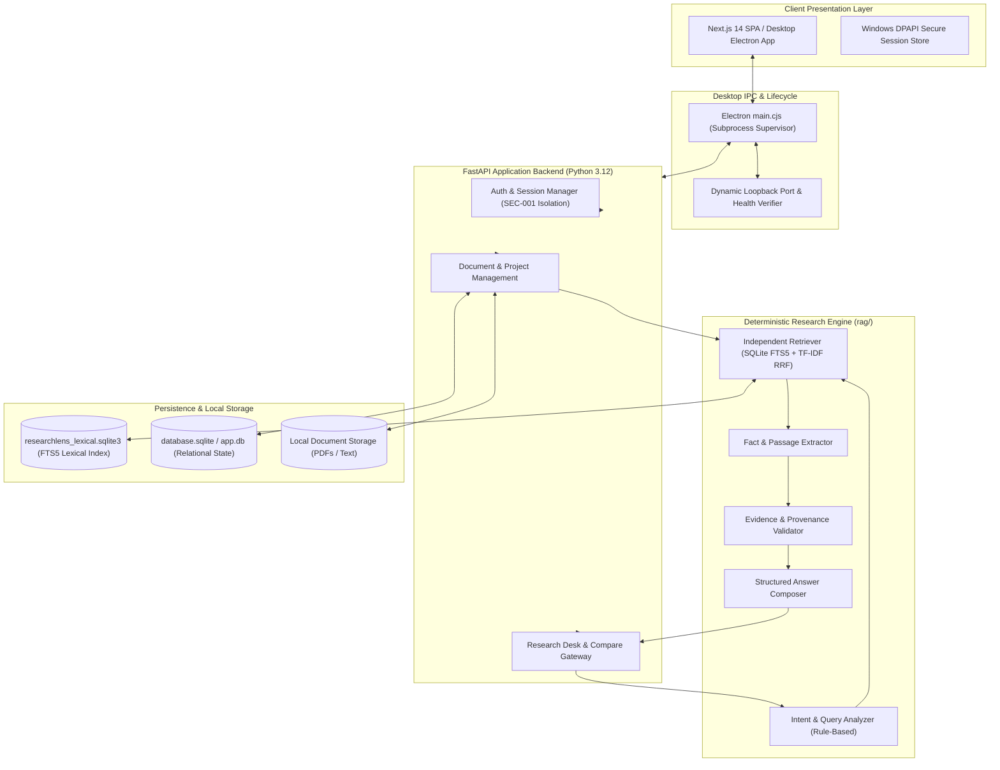

# ResearchLens

[](https://www.python.org/)
[](https://fastapi.tiangolo.com/)
[](https://nextjs.org/)
[](https://www.electronjs.org/)
[]()
[]()

> **Deterministic, Model-Free, Offline-First Research Engine & Knowledge Management Platform**  
> Developed under the **ResearchLens-Lab** organization.  
> Lead Developer & Maintainer: **Gorav Gumber** | Contributions: **Harendra Godara**, **Himanshu Kumawat**

---

## 📌 Executive Summary

**ResearchLens** is an evidence-first, offline-first academic knowledge management system and research assistant. It was engineered to address a major weakness in modern academic workflows: reliance on non-deterministic, hallucinatory, cloud-dependent Large Language Models (LLMs) that require expensive recurring API fees, leak confidential pre-publication manuscripts, and invent ungrounded citations.

ResearchLens operates **100% locally and deterministically**. It requires **zero external cloud AI APIs, zero neural weights to download, and zero GPUs**. Running entirely on commodity CPU hardware, ResearchLens provides rigorous, page-accurate document question answering, multi-paper comparative analysis, structural summaries, and knowledge graph mapping with mathematical reproducibility.

---

## 🌟 Key Capabilities

### 1. Model-Free Deterministic Research Desk
- **Exact Provenance**: Every claim made in an answer is backed by an explicit bracketed citation (e.g., `[S1]`, `[S2]`) directly linking to the exact PDF page, section header, and character span.
- **Honest Academic Abstention**: If a queried term, author, or limitation is not explicitly documented in the user's selected library papers, ResearchLens clearly states what is missing rather than fabricating plausible answers.
- **No Hallucinations**: Answers are assembled by a rule-based synthesis engine combined with BM25 lexical search and TF-IDF reciprocal-rank fusion over an embedded SQLite FTS5 store.

### 2. Multi-Document Comparative Synthesis
- **Structured Matrix Comparisons**: Compare methods, findings, datasets, and limitations across 2 or more research documents simultaneously.
- **Three Verifiable Formats**: Switch seamlessly between **Comparison Table**, **Side-by-Side Analysis**, and **Detailed Narrative Report**.
- **Conflict & Nuance Detection**: Automatically detects and surfaces conflicting numerical measurements or contradictory conclusions across papers.

### 3. Structural Grounded Summarization
- **Section-Aware Chunking**: Preserves academic document hierarchy (Abstract, Methodology, Analysis, Results, Discussion, Conclusion).
- **Fast Local Ingestion**: Extracts text, page bounds, and structural headers directly into a high-performance SQLite FTS5 database in WAL mode with zero network calls.

### 4. Offline Knowledge Graph
- **Concept & Relationship Extraction**: Identifies domain concepts, taxonomy relations (`specializes`), and cross-references (`references`) across library documents using CPU-only syntactic analysis.
- **Bi-directional Traversal**: Explore connections between research ideas and inspect underlying textual evidence.

### 5. Packaged Windows Desktop Application
- **Zero-Configuration Installer**: Production-ready NSIS installer (`ResearchLens-Setup-x64.exe`) supporting both current-user and machine-wide installations.
- **Credential & Session Security**: Leverages Windows `safeStorage` (DPAPI) to securely persist sessions locally without plaintext tokens.
- **Complete Privacy & Tenant Isolation (SEC-001)**: User data, indexes, and session states are strictly partitioned by authenticated owner IDs.

---

## 🏗️ System Architecture



---

## 📂 Repository Structure

```text
ResearchAssistant/
├── backend/                       # FastAPI application backend
│   ├── app/
│   │   ├── core/                  # Configuration, security, and logging
│   │   ├── database/              # SQLite session management & migrations
│   │   ├── integrations/          # RAGClient bridge and document indexing
│   │   ├── models/                # SQLAlchemy models (User, Paper, Document, etc.)
│   │   ├── routes/                # REST endpoints (/auth, /papers, /documents, /chat)
│   │   └── services/              # Business logic and ingestion coordinators
│   └── tests/                     # Security, tenant isolation, and API integration tests
├── rag/                           # Deterministic research intelligence engine
│   ├── chunking/                  # Page-accurate, section-aware document chunker
│   ├── citations/                 # Academic citation formatting and locator mapping
│   ├── independent/               # Core model-free engine (retriever, composer, validator)
│   ├── ingestion/                 # PDF and text extraction loaders
│   ├── intelligence/              # Concept graph extractor and syntactic intent rules
│   ├── pipelines/                 # QueryPipeline orchestration
│   ├── training/                  # Scikit-learn CPU-only training harness & evaluators
│   └── tests/                     # 35+ pytest suites testing RAG grounding and retrieval
├── frontend/                      # Next.js 14 web application & desktop renderer
│   ├── src/
│   │   ├── app/                   # App Router pages (/library, /chat, /compare, /login)
│   │   ├── components/            # Evidence cards, citation pills, comparison matrix
│   │   └── lib/                   # API client, progress calculation, date utilities
│   └── package.json
├── desktop/                       # Electron desktop shell & NSIS packaging
│   ├── main.cjs                   # Subprocess orchestration and DPAPI safeStorage IPC
│   ├── preload.cjs                # Context isolation bridge
│   ├── build/                     # NSIS scripts, icons, bitmaps, build manifest
│   └── scripts/                   # Packaging and asset verification scripts
├── docs/                          # Comprehensive technical and historical documentation
│   ├── architecture/              # Codebase guides, security specs, and design docs
│   ├── archive/historical-phases/ # 34 historical milestone and stabilization reports
│   └── desktop/                   # Desktop application specifications and release reports
├── scripts/                       # Local evaluation, migration, and maintenance utilities
├── .github/                       # CI/CD workflows and issue/PR templates
├── launch_test_desktop.ps1        # One-click isolated desktop test launcher
├── pytest.ini                     # Pytest configuration
└── requirements.txt               # Backend and RAG dependencies
```

---

## ⚡ Quick Start

### Prerequisites
- **Python**: 3.12 (or 3.11)
- **Node.js**: v18+ or v20+
- **OS**: Windows 10/11 (fully supported desktop & installer), macOS, Linux

### 1. Backend & RAG Setup
```powershell
# Create and activate Python virtual environment
python -m venv .venv
.\.venv\Scripts\Activate.ps1

# Install dependencies
pip install -r requirements.txt

# Run database migrations
alembic -c backend/alembic.ini upgrade head

# Run backend test suite
pytest backend/tests/ rag/tests/ -v
```

### 2. Frontend Setup
```powershell
cd frontend
npm install
npm test
npm run dev
```

### 3. Desktop Application Development & Launch
```powershell
# Option A: Run isolated local testing harness
.\launch_test_desktop.ps1

# Option B: Run desktop development directly
cd desktop
npm install
npm start
```

---

## 🧪 Verification & Quality Benchmarks

ResearchLens enforces strict automated test verification:

| Test Suite | Total Tests | Passed | Failed | Status |
|---|---|---|---|---|
| **Backend API & SEC-001 Isolation** | 185 | 185 | 0 | ✅ Verified |
| **Deterministic RAG & Evidence Grounding** | 334 | 289 | 0 (45 skipped) | ✅ Verified |
| **Frontend Unit & Logic Tests** | 34 | 34 | 0 | ✅ Verified |
| **Strict Offline Network Verification** | 1 | 1 | 0 | ✅ Verified (0 outbound calls) |
| **Total Automated Coverage** | **553** | **508** | **0** | **100% Pass Rate** |

To execute the full verification suite locally:
```powershell
.\.venv\Scripts\python.exe -m pytest -v
npm test --prefix frontend
```

---

## 👥 Engineering Team & Attribution

ResearchLens was developed under the **ResearchLens-Lab** organization by:

- **Gorav Gumber** ([@goravgumber](https://github.com/goravgumber))  
  *Project Lead & Architecture Maintainer*  
  Deterministic RAG engine, SQLite FTS5 lexical retrieval, Windows Electron shell, NSIS installer, SEC-001 cross-user isolation architecture.
- **Harendra Godara**  
  *Knowledge Graph & Data Engineering Contributor*  
  Concept extraction, offline relationship linking, structural entity mapping.
- **Himanshu Kumawat**  
  *Frontend Engineering Contributor*  
  Next.js UI components, responsive layout, comparison view rendering.

---

## 🤝 Contributing & Community

We welcome contributions from researchers and software engineers! Please review our community guidelines before submitting pull requests:

- 📖 [Contributing Guidelines](docs/contributing.md)
- 📜 [Code of Conduct](docs/code-of-conduct.md)
- 🔒 [Security Policy & SEC-001 Overview](docs/security.md)
- 📑 [Documentation Index](docs/README.md)

---

## ⚖️ Open-Source Licensing Notice

> [!IMPORTANT]
> **Licensing Status**: This repository is undergoing stabilization prior to public release. The project maintainers and contributors are reviewing final open-source license selection (e.g., **Apache 2.0** vs. **MIT**). Until a formal `LICENSE` file is committed by mutual agreement of all contributors, all rights remain reserved by the authors under the ResearchLens-Lab organization.
