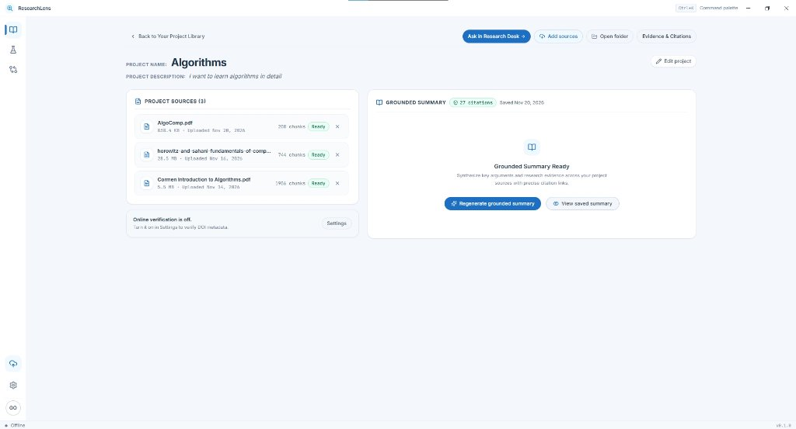
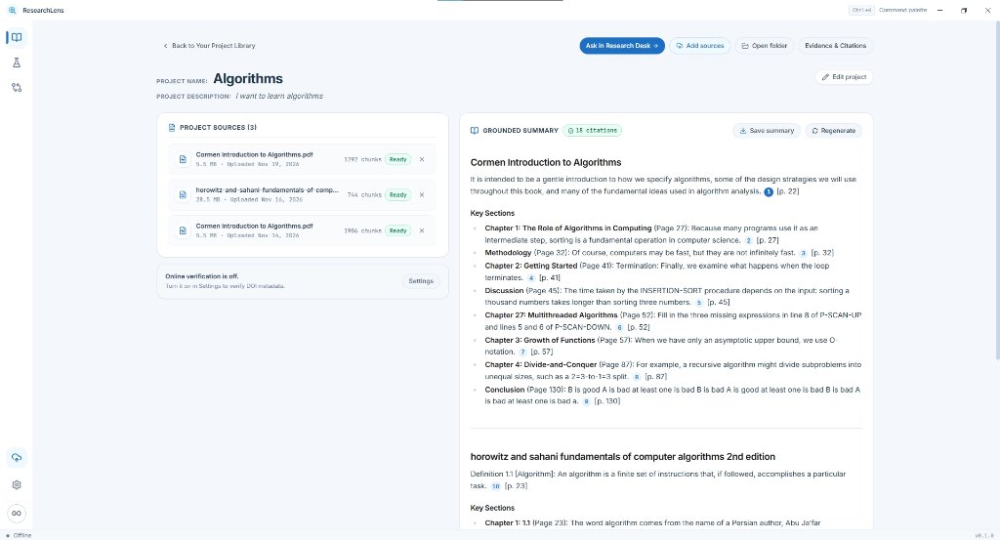
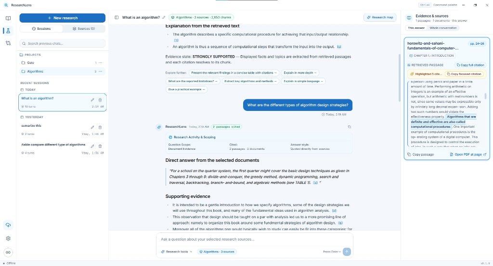
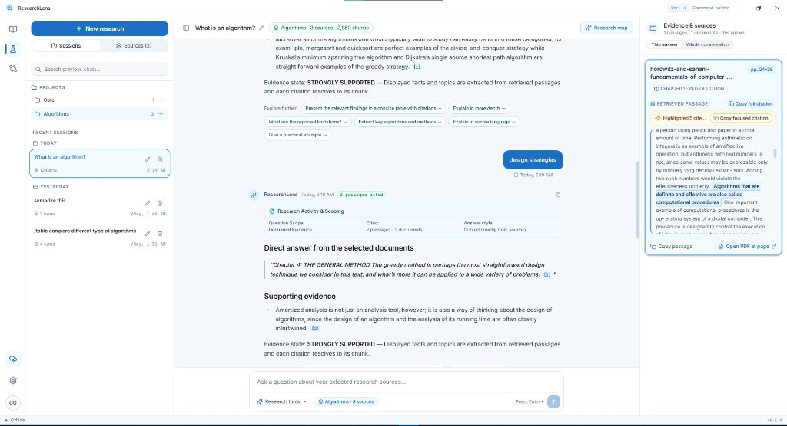
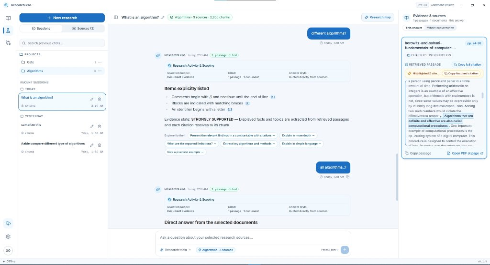
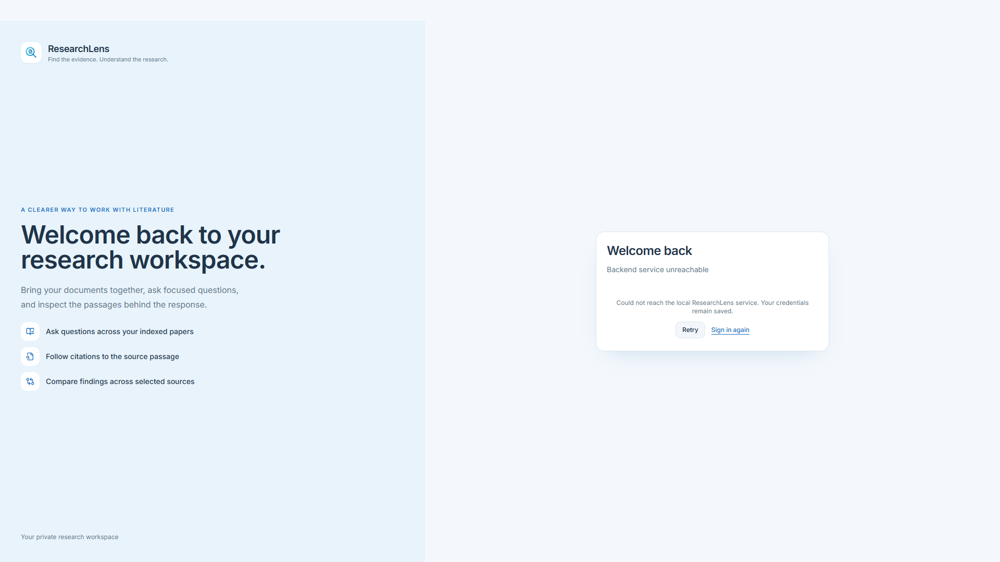
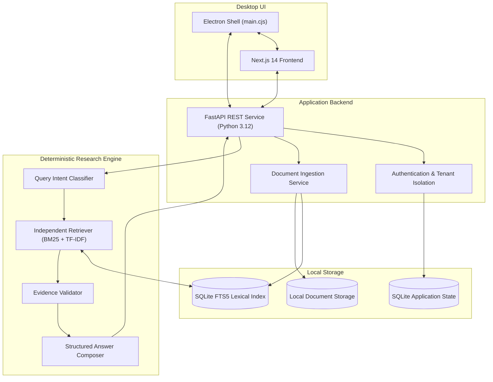

# ResearchLens

ResearchLens is a desktop research workspace for organizing academic and technical documents, searching their content, comparing information across sources and reviewing evidence-backed answers.

The application runs locally on Windows, macOS, and Linux, providing document ingestion, lexical retrieval, side-by-side comparison tables, and provenance-grounded question answering.

---

## Technical Overview

The default ResearchLens research engine operates entirely on local CPU resources without requiring a cloud LLM API, neural embedding downloads, or dedicated GPU hardware.

### Default Local Research Engine

- **Index and Storage**: Document text, section headings, and page boundaries are stored in an embedded SQLite database using the FTS5 full-text extension with WAL mode enabled.
- **Retrieval Pipeline**: Combines SQLite FTS5 BM25 lexical ranking with local TF-IDF query expansion and reciprocal-rank fusion (RRF).
- **Answer Composition**: Uses deterministic extractive answer composition to assemble responses directly from retrieved passages.
- **Evidence Validation**: Verifies claims against source passages and generates inline citation markers (`[S1]`, `[S2]`) linked to explicit document filenames, page numbers, and section headers.
- **Academic Abstention**: When queried facts or definitions are absent from selected documents, the engine reports that information was not found rather than inferring ungrounded text.
- **Optional Integrations**: Configurable settings support optional local Ollama models or cloud providers when explicitly enabled by the user.

---

## Desktop Application Screenshots

### 1. Research Library and Grounded Summary
The project library displays indexed sources, chunk counts, extraction status, and generated section-by-section summaries with citation anchors.



---

### 2. Document Sources and Section Extraction
Document ingestion parses PDF structure, extracting headings, page boundaries, and section text into the local lexical index.



---

### 3. Research Desk Question and Answering
Users query indexed documents through the Research Desk. Answers present direct passages from selected documents with evidence status indicators.



---

### 4. Evidence and Citation Inspector
Selecting any inline citation opens the Evidence Inspector, showing the exact page reference, section header, and highlighted source text.



---

### 5. Multi-Turn Exploration
The Research Desk supports multi-turn query refinement across selected project documents while preserving citation linkages and evidence boundaries.



---

### 6. Desktop Settings and Configuration
Desktop settings manage storage directories, network preferences, and optional provider connections.



---

## System Architecture



---

## Repository Structure

```text
ResearchAssistant/
├── backend/                       # FastAPI backend service
│   ├── app/
│   │   ├── core/                  # Configuration, security, dependencies
│   │   ├── database/              # SQLite database session and models
│   │   ├── integrations/          # RAGClient bridge and document indexing
│   │   ├── routes/                # REST endpoints (/auth, /papers, /documents, /chat)
│   │   └── services/              # Document, project, and search services
│   └── tests/                     # Backend security, isolation, and API tests
├── rag/                           # Deterministic research engine
│   ├── chunking/                  # Page-accurate, section-aware chunker
│   ├── citations/                 # Citation formatting and locator mapping
│   ├── independent/               # Retrieval, composition, and evidence validation
│   ├── ingestion/                 # Document loaders and structure extractors
│   ├── intelligence/              # Concept graph extractor and intent rules
│   ├── pipelines/                 # High-level query and ingest pipelines
│   ├── training/                  # Scikit-learn evaluation metrics and dataset tools
│   └── tests/                     # RAG test suites
├── frontend/                      # Next.js 14 web client and desktop renderer
│   ├── src/
│   │   ├── app/                   # Next.js App Router pages
│   │   ├── components/            # UI components and workbenches
│   │   └── lib/                   # API client and utility modules
│   └── package.json
├── desktop/                       # Electron desktop application
│   ├── main.cjs                   # Main process supervisor and IPC handlers
│   ├── preload.cjs                # Context bridge
│   ├── build/                     # NSIS installer configuration and icons
│   └── scripts/                   # Desktop packaging scripts
├── docs/                          # Project technical documentation
│   ├── architecture/              # Architecture guides and specifications
│   ├── assets/screenshots/        # Application screenshots
│   ├── backend/                   # Backend API overview
│   ├── desktop/                   # Desktop runtime and security model
│   └── rag/                       # RAG engine documentation
├── scripts/                       # Maintenance and evaluation utilities
├── pytest.ini                     # Pytest configuration
└── requirements.txt               # Python dependencies
```

---

## Getting Started

### Prerequisites

- Python 3.11 or 3.12
- Node.js 18 or 20
- npm 9+

### Backend Setup

```bash
# Create and activate virtual environment
python -m venv .venv
source .venv/bin/activate  # Windows: .\.venv\Scripts\Activate.ps1

# Install dependencies
pip install -r requirements.txt

# Run database migrations
alembic -c backend/alembic.ini upgrade head

# Run backend test suite
pytest backend/tests/ rag/tests/ -v
```

### Frontend Setup

```bash
cd frontend
npm install
npm test
npm run dev
```

### Running the Desktop Application

```bash
# Option 1: Development mode
cd desktop
npm install
npm start

# Option 2: Run isolated acceptance test environment
.\launch_test_desktop.ps1
```

---

## Automated Verification

The test suite covers backend API routes, tenant isolation, lexical indexing, answer composition, and frontend components:

- **Backend and Engine Tests**: 474 passed, 0 failed, 45 skipped (`pytest backend/tests/ rag/tests/`)
- **Frontend Tests**: 34 passed, 0 failed (`npm test --prefix frontend`)
- **Strict Offline Network Verification**: 1 passed (`test_offline_strict.py` confirms 0 outbound requests)

---

## Contributing and Security

- [Contributing Guidelines](docs/contributing.md)
- [Code of Conduct](docs/code-of-conduct.md)
- [Security Policy](docs/security.md)
- [Documentation Index](docs/README.md)

---

## Authors & Project Team

ResearchLens is a collaborative team-developed research platform created under the **ResearchLens-Lab** organization, led by Gorav Gumber:

- **Gorav Gumber** — Project Lead, Technical Architect and RAG Lead.
- **Himanshu Kumawat** — Frontend Lead.
- **Harendra Godara** — Knowledge Graph Lead.
- **Abhay Kumar Singh** — Backend and Database Contributor.

The project welcomes external contributors through our [Contributing Guidelines](docs/contributing.md).

---

## License

This repository is being prepared for open-source release. Final license selection (such as Apache-2.0 or MIT) and author attribution will be finalized by the project contributors prior to public release. All rights remain reserved by the authors under the ResearchLens-Lab organization.
