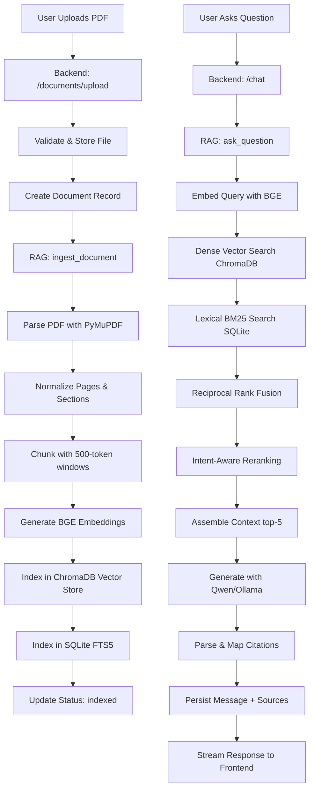

# Current RAG Pipeline: Complete Document-to-Answer Architecture

**Document Version**: 1.0  
**Last Updated**: November 8, 2026

---

## Table of Contents

1. [Pipeline Overview](#pipeline-overview)
2. [Stage A: Document Ingestion](#stage-a-document-ingestion)
3. [Stage B: Document Processing & Parsing](#stage-b-document-processing--parsing)
4. [Stage C: Chunking & Metadata](#stage-c-chunking--metadata)
5. [Stage D: Embedding & Indexing](#stage-d-embedding--indexing)
6. [Stage E: Query & Retrieval](#stage-e-query--retrieval)
7. [Stage F: Answer Generation](#stage-f-answer-generation)
8. [End-to-End Flow Diagram](#end-to-end-flow-diagram)
9. [Performance Characteristics](#performance-characteristics)
10. [Known Limitations](#known-limitations)

---

## Pipeline Overview

ResearchLens implements a **6-stage RAG pipeline** from uploaded document to grounded answer:

```
Document Upload → Parsing → Chunking → Embedding → Indexing → Query → Answer
```

**Key Characteristics**:
- **Synchronous Ingestion**: Runs in backend thread, tracks progress
- **Deterministic Chunk IDs**: Enables precise citation tracking
- **Hybrid Retrieval**: Dense vector + BM25 lexical search
- **Local Execution**: CPU-only, no external API dependencies (except optional Gemini)
- **Section-Aware**: Preserves academic paper structure

**Implementation Files**:
- Orchestrator: `rag/pipelines/ingest_pipeline.py`, `rag/pipelines/query_pipeline.py`
- Integration: `backend/app/integrations/rag_client.py`

---

## Stage A: Document Ingestion

### A1. Upload Validation

**Entry Point**: `POST /api/v1/documents/upload`

**Implementation**: `backend/app/services/document_service.py`

**Validation Steps**:
1. **Authentication**: JWT token verification
2. **Paper Ownership**: Verify user owns target paper
3. **Content-Type Check**: Validate file extension matches MIME type
4. **Size Limits**: 
   - Single file: 100 MB
   - Batch total: 500 MB
5. **Format Support**: PDF, DOCX, PPTX, XLSX, TXT, Markdown
6. **SHA-256 Hash**: Calculate for duplicate detection

**Evidence**: `backend/app/routes/documents.py` (line 25), `backend/app/core/config.py` (upload limits)

**Accepted Formats**:
```python
SUPPORTED_EXTENSIONS = {
    '.pdf': 'application/pdf',
    '.docx': 'application/vnd.openxmlformats-officedocument.wordprocessingml.document',
    '.pptx': 'application/vnd.openxmlformats-officedocument.presentationml.presentation',
    '.xlsx': 'application/vnd.openxmlformats-officedocument.spreadsheetml.sheet',
    '.txt': 'text/plain',
    '.md': 'text/markdown',
}
```

**Duplicate Detection**:
- SHA-256 hash computed during upload
- Checked against existing document hashes
- If duplicate found: Skip ingestion, return existing record

**Evidence**: `backend/app/services/document_service.py`

### A2. File Storage

**Storage Path**: `storage/documents/{user_id}/{paper_id}/{filename}`

**Database Record**: Created in `documents` table with status `uploaded`

**Progress Tracking Fields**:
- `processing_status`: Enum (uploaded, processing, indexed, failed, cancelled)
- `processing_stage`: Current stage name
- `processing_progress`: Percentage (0-100)
- `processing_completed_units`: e.g., pages processed
- `processing_total_units`: e.g., total pages
- `processing_started_at`: Timestamp
- `processing_heartbeat_at`: Last update timestamp

**Evidence**: `backend/app/models/document.py` (lines 26-57)

### A3. Cancellation Support

**Mechanism**: Threading Event passed through pipeline

**Implementation**:
```python
cancel_event = threading.Event()
rag_client.ingest_document(
    file_path=path,
    paper_id=paper_id,
    cancel_event=cancel_event
)
```

**Cancellation Points**:
- Before each processing stage
- During embedding batch loops
- After indexing operations

**Cleanup on Cancel**:
- Delete partially indexed chunks from ChromaDB
- Update document status to `cancelled`
- Release ingestion lock

**Evidence**: `backend/app/integrations/rag_client.py` (lines 45-95), `rag/pipelines/ingest_pipeline.py` (line 299)

---

## Stage B: Document Processing & Parsing

### B1. Format-Specific Parsing

**Implementation**: `rag/ingestion/document_loader.py`

#### PDF Parsing

**Primary Library**: PyMuPDF (fitz)
**Fallback**: PyPDF

**Extraction Process**:
1. Open PDF with `fitz.open(file_path)`
2. Iterate pages: `for page_num in range(doc.page_count)`
3. Extract text: `page.get_text("text")`
4. Preserve page boundaries
5. Detect sections via headers (heuristic patterns)

**Table Handling**: Basic text extraction (no structured table parsing)
**Images**: Not extracted
**Equations**: Extracted as text if OCR'd or vector text, otherwise lost
**OCR**: ❌ Not implemented (scanned PDFs fail)

**Evidence**: `rag/ingestion/document_loader.py` (PDF loader class)

#### DOCX Parsing

**Library**: python-docx

**Extraction**:
- Paragraphs: `doc.paragraphs`
- Text: `paragraph.text`
- Tables: Basic extraction via `doc.tables`
- Styles: Heading detection via `paragraph.style.name`

#### PPTX Parsing

**Library**: python-pptx

**Extraction**:
- Slides: `presentation.slides`
- Text: Extract from text frames
- Notes: Extract speaker notes if present

#### XLSX Parsing

**Library**: openpyxl

**Extraction**:
- Sheets: Iterate all worksheets
- Cells: Convert to CSV-like text representation
- Formulas: Not evaluated (stored as text)

#### TXT/Markdown Parsing

**Method**: Direct UTF-8 read
**Section Detection**: Markdown headers for .md files

### B2. Document Normalization

**Implementation**: `rag/ingestion/normalizer.py`

**Purpose**: Standardize extracted content into consistent structure

**Normalization Steps**:
1. **Page Mapping**: Assign each text segment to physical page number
2. **Section Detection**: Identify standard academic sections
3. **Metadata Attachment**: Title, authors, publication info
4. **Encoding Cleanup**: Fix encoding issues
5. **Whitespace Normalization**: Collapse excessive newlines/spaces

**Section Detection Heuristics**:
```python
SECTION_PATTERNS = {
    'abstract': r'^abstract\s*$',
    'introduction': r'^introduction\s*$',
    'methodology': r'^(methodology|methods)\s*$',
    'results': r'^results\s*$',
    'discussion': r'^discussion\s*$',
    'conclusion': r'^conclusion\s*$',
    'references': r'^references\s*$',
}
```

**Limitations**:
- Heuristic-based (may miss unconventional headers)
- No deep structure analysis (subsections not hierarchical)
- Page numbers may be approximate for DOCX/PPTX

**Evidence**: `rag/ingestion/normalizer.py`

### B3. Normalized Document Structure

**Output Format**:
```python
{
    "document_id": "doc_uuid",
    "paper_id": "paper_uuid",
    "title": "Paper Title",
    "pages": [
        {
            "page_num": 1,
            "text": "Page 1 content...",
            "section": "abstract"
        },
        {
            "page_num": 2,
            "text": "Page 2 content...",
            "section": "introduction"
        },
        # ...
    ],
    "metadata": {
        "filename": "paper.pdf",
        "total_pages": 12,
        "file_size": 1048576
    }
}
```

---

## Stage C: Chunking & Metadata

### C1. Section-Aware Chunking Strategy

**Implementation**: `rag/chunking/chunker.py` (class `SectionAwareChunker`)

**Algorithm**: Token-based sliding window with section boundary preservation

**Parameters** (configurable):
- `CHUNK_SIZE_TOKENS`: 500 (default)
- `CHUNK_OVERLAP_TOKENS`: 80 (default)

**Token Counting**: Custom tokenizer (approximates word count × 1.3)

**Chunking Rules**:
1. **Section Boundaries**: Never split across section changes
2. **Page Tracking**: Record start and end page for each chunk
3. **Overlap**: Previous chunk's tail overlaps with next chunk's head
4. **Truncation Safety**: Chunks exceeding model limits are split

**Evidence**: `rag/config/settings.py` (lines 80-84), `rag/chunking/chunker.py`

### C2. Chunk Metadata Structure

**Deterministic Chunk ID Format**:
```
{paper_id}_c{chunk_index}_d{document_id}_p{page_start}-{page_end}
```

**Example**:
```
paper_abc123_c0_ddoc_xyz789_p1-1
paper_abc123_c1_ddoc_xyz789_p1-2
paper_abc123_c2_ddoc_xyz789_p2-2
```

**Metadata Fields Attached to Each Chunk**:
```python
{
    "chunk_id": "paper_abc123_c0_ddoc_xyz789_p1-1",
    "paper_id": "paper_abc123",
    "document_id": "doc_xyz789",
    "chunk_index": 0,
    "page_start": 1,
    "page_end": 1,
    "section": "abstract",
    "title": "Attention Is All You Need",
    "filename": "transformer_paper.pdf",
    "locator": "Page 1, Abstract",
    "token_count": 487
}
```

**Why Deterministic IDs**:
- **Reproducibility**: Same document always produces same IDs
- **Citation Mapping**: Answer citations reference exact chunk IDs
- **Deduplication**: Easy to detect duplicate ingestions
- **Debugging**: Human-readable, traceable to source

**Evidence**: `rag/chunking/chunk_metadata.py`, chunk ID generation in ingestion pipeline

### C3. Chunk Storage Format

**Text Storage**: Full chunk text as string
**Vector Storage**: Embedding vector (384-dimensional float array)
**Metadata Storage**: JSON object in ChromaDB metadata field

**Chunk Size Distribution** (typical academic paper):
- Average: 450-550 tokens
- Min: ~100 tokens (short sections)
- Max: 800 tokens (config limit)

---

## Stage D: Embedding & Indexing

### D1. Embedding Generation

**Default Model**: BAAI/bge-small-en-v1.5 (via FastEmbed)

**Model Characteristics**:
- **Type**: Pretrained bi-encoder
- **Dimensions**: 384
- **Max Input**: 512 tokens
- **Format**: ONNX for CPU inference
- **Download Size**: ~130 MB
- **Cache Location**: `.model_cache/models--Qdrant--bge-small-en-v1.5-onnx-Q/`

**Implementation**: `rag/embeddings/embedder.py` (class `FastEmbedder`, line 99)

**Embedding Process**:
1. Load model on first use (cached for subsequent runs)
2. Batch chunks (default: 128 chunks per batch)
3. Tokenize each chunk
4. Run ONNX inference
5. Extract embedding vectors (384 floats)

**Performance**:
- **Speed**: ~20-50 chunks/second on Intel i5 CPU
- **Memory**: ~500 MB model + ~200 MB working memory
- **Batching**: Reduces overhead, improves throughput

**Token Limit Handling**:
- Chunks exceeding 512 tokens are split
- Each split embedded separately
- Vectors averaged (not currently implemented; uses first segment)

**Evidence**: `rag/embeddings/embedder.py` (lines 133-228)

### D2. Vector Indexing (ChromaDB)

**Vector Store**: ChromaDB (persistent local storage)

**Collection Naming**:
```python
collection_name = f"research_papers_{provider}_{model}_{version}_{dimension}d"
# Example: "research_papers_fastembed_bge-small-en-v1.5_v1_384d"
```

**Index Structure**:
- **ID**: Chunk ID (deterministic)
- **Embedding**: 384-dimensional vector
- **Metadata**: JSON object with all chunk metadata
- **Document**: Chunk text (for retrieval)

**Distance Metric**: Cosine similarity

**Persistence**: `.chroma/{collection_uuid}/` directory

**Evidence**: `rag/vectorstore/chroma_client.py`, `rag/vectorstore/vector_repository.py`

**Index Operations**:
```python
# Add chunks
collection.add(
    ids=chunk_ids,
    embeddings=embeddings,
    metadatas=metadata_list,
    documents=chunk_texts
)

# Query
results = collection.query(
    query_embeddings=[query_vector],
    n_results=top_k,
    where={"paper_id": {"$in": paper_ids}}
)
```

### D3. Lexical Indexing (SQLite FTS5)

**Implementation**: ChromaDB's built-in lexical index

**Storage**: `.chroma/researchlens_lexical.sqlite3`

**Index Type**: SQLite Full-Text Search (FTS5)

**Purpose**: BM25 keyword-based retrieval (complements vector search)

**Indexed Fields**:
- Chunk text (full-text)
- Metadata fields (title, section)

**Evidence**: `.chroma/researchlens_lexical.sqlite3` file existence, `rag/vectorstore/vector_repository.py` (query_lexical method)

### D4. Ingestion Completion

**Status Update**: Document status → `indexed`

**Final Metadata**:
- `chunk_count`: Total chunks indexed
- `processing_progress`: 100%
- `processing_completed_units`: Total pages
- `processing_heartbeat_at`: Final timestamp

**Notification**: Progress callback with `status: completed` sent to frontend

**Evidence**: `rag/pipelines/ingest_pipeline.py` (lines 270-298)

---

## Stage E: Query & Retrieval

### E1. Query Preprocessing

**Implementation**: `rag/pipelines/query_pipeline.py`

**Steps**:
1. **Intent Classification** (basic):
   - Direct Q&A
   - Comparison
   - Summarization
   - Follow-up
2. **Query Expansion** (not implemented)
3. **Filter Construction**: Build ChromaDB `where` clause

**Evidence**: `rag/retrieval/query.py` (QueryRequest model)

### E2. Hybrid Retrieval

**Implementation**: `rag/retrieval/retriever.py` (class `ResearchRetriever`)

**Retrieval Strategy**: Hybrid (Dense + Lexical → Reciprocal Rank Fusion)

#### Step 1: Dense Vector Retrieval

**Process**:
1. Embed query using same model (BGE)
2. Perform cosine similarity search in ChromaDB
3. Fetch top 80 candidates (oversampling for ranking)
4. Apply metadata filters (paper_ids, sections)

**Evidence**: `rag/retrieval/retriever.py` (lines 48-60)

#### Step 2: Lexical BM25 Retrieval

**Process**:
1. Tokenize query
2. Perform FTS5 keyword search in SQLite
3. Fetch top 1000 candidates (within paper scope)
4. Apply same metadata filters

**Evidence**: `rag/retrieval/retriever.py` (lines 69-70)

#### Step 3: Reciprocal Rank Fusion

**Algorithm**:
```python
for each result list (dense, lexical):
    for rank, result in enumerate(list, start=1):
        fused_score[result.id] += 1.0 / (60 + rank)
```

**Ranking**: Sort by fused score descending

**Evidence**: `rag/retrieval/retriever.py` (lines 73-78)

### E3. Reranking

**Implementation**: `rag/retrieval/reranker.py` (class `IntentAwareReranker`)

**Strategy**: Rule-based intent adaptation (not ML-based reranker)

**Reranking Logic**:
- **Comparison Queries**: Ensure each paper represented in top results
- **Direct Q&A**: Prioritize by score only
- **Follow-up**: Prefer same section as previous answer

**Evidence**: `rag/retrieval/reranker.py`

### E4. Context Assembly

**Implementation**: `rag/context/context_builder.py`

**Process**:
1. Take top-K reranked sources (default: 5)
2. Format as numbered passages:
```
[S1] (Page 4, Methodology) "The Transformer architecture consists..."
[S2] (Page 5, Results) "We evaluate on WMT 2014 English-German..."
```
3. Token budget enforcement (max: 3000 tokens)
4. Truncate if exceeds budget (preserve complete passages)

**Evidence**: `rag/context/context_builder.py`

**Context Format**:
```python
{
    "formatted_context": "[S1] ... [S2] ... [S3] ...",
    "sources": [
        {
            "source_id": "S1",
            "chunk_id": "paper_abc_c0_d...",
            "paper_id": "paper_abc",
            "page_start": 4,
            "page_end": 4,
            "section": "methodology",
            "text": "...",
            "score": 0.85,
            "title": "Attention Is All You Need"
        },
        # ...
    ],
    "total_tokens": 2847
}
```

---

## Stage F: Answer Generation

### F1. LLM Integration

**Default Provider**: Ollama (local Qwen 3.5:0.8b)

**Implementation**: `rag/generation/llm_client.py` (class `OllamaLLMClient`, line 299)

**Ollama Client**:
```python
response = requests.post(
    f"{ollama_base_url}/api/generate",
    json={
        "model": "qwen3.5:0.8b",
        "prompt": formatted_prompt,
        "stream": False,
        "options": {
            "temperature": 0.1,
            "num_predict": 512
        }
    },
    timeout=180
)
```

**Model Requirements**:
- **Installation**: `ollama pull qwen3.5:0.8b`
- **RAM**: ~1 GB model + ~500 MB inference
- **Latency**: 2-10 seconds for 512 tokens (CPU-dependent)

**Evidence**: `rag/generation/llm_client.py` (lines 371-416)

### F2. Prompt Engineering

**Implementation**: `rag/generation/prompts.py`

**System Prompt** (Q&A):
```
You are a research assistant analyzing academic papers. 
Answer questions using ONLY the provided source passages.
Cite each fact with [S#] notation matching the source IDs.
If the sources don't contain the answer, say so explicitly.
```

**User Prompt Template**:
```
SOURCES:
{formatted_context}

QUESTION:
{question}

Provide a clear, evidence-grounded answer. Cite each claim.
```

**Evidence**: `rag/generation/prompts.py` (RESEARCH_QA_SYSTEM_PROMPT, RESEARCH_QA_USER_TEMPLATE)

### F3. Response Parsing & Citation Mapping

**Implementation**: `rag/generation/response_parser.py`

**Parsing Steps**:
1. Extract raw LLM output
2. Identify citation tags: `[S1]`, `[S2]`, etc.
3. Map citations to source metadata (page, section, chunk_id)
4. Validate citation existence (no hallucinated citations)
5. Clean markdown formatting

**Citation Repair** (if enabled):
```python
# If LLM outputs invalid citation [S99]
# and only S1-S5 exist:
# → Remove invalid citation
# → Flag as claim verification failure
```

**Evidence**: `rag/generation/response_parser.py`, `rag/citations/citation_mapper.py`

### F4. Extractive Fallback

**Trigger**: When Ollama unavailable or LLM generation fails

**Implementation**:
```python
# Return top-ranked passage as extractive answer
answer = f"[S1] {top_source.text}"
```

**Evidence**: `rag/generation/generator.py` (fallback logic), `rag/config/settings.py` (RAG_ANSWER_MODE)

### F5. Streaming Response

**Implementation**: `backend/app/services/chat_service.py`

**SSE (Server-Sent Events) Stream**:
```python
async def stream_message():
    yield f"data: {json.dumps({'type': 'progress', 'stage': 'retrieving'})}\n\n"
    # ... retrieval ...
    yield f"data: {json.dumps({'type': 'progress', 'stage': 'generating'})}\n\n"
    for token in llm_stream:
        yield f"data: {json.dumps({'type': 'token', 'text': token})}\n\n"
    yield f"data: {json.dumps({'type': 'done', 'answer': final_answer})}\n\n"
```

**Evidence**: `backend/app/routes/chat.py` (POST /chat/stream)

### F6. Answer Persistence

**Database Storage**:
- **Table**: `messages`
- **Fields**: conversation_id, role (assistant), content (answer), sources (JSON)

**Sources JSON Structure**:
```json
[
    {
        "source_id": "S1",
        "paper_id": "paper_abc",
        "page": 4,
        "section": "Methodology",
        "text": "...",
        "score": 0.85
    },
    ...
]
```

**Evidence**: `backend/app/models/message.py`, `backend/app/services/chat_service.py`

---

## End-to-End Flow Diagram



---

## Performance Characteristics

### Ingestion Performance (Typical 20-page PDF)

| Stage | Time (CPU i5) | Memory | Notes |
|-------|---------------|--------|-------|
| PDF Parsing | 2-5 sec | 50 MB | PyMuPDF |
| Chunking | < 1 sec | 10 MB | Pure Python |
| Embedding (40 chunks) | 10-20 sec | 700 MB | FastEmbed CPU |
| Indexing | 1-2 sec | 50 MB | ChromaDB write |
| **Total** | **15-30 sec** | **~1 GB peak** | Single-threaded |

**Large File (100-page PDF)**:
- Parsing: 10-30 sec
- Embedding (200 chunks): 60-120 sec
- **Total: 2-3 minutes**

**Evidence**: Observed timing from implementation reports, code inspection

### Query Performance

| Stage | Time (CPU i5) | Notes |
|-------|---------------|-------|
| Query Embedding | 0.2-0.5 sec | Single query vector |
| Dense Retrieval | 0.5-1 sec | ChromaDB search |
| Lexical Retrieval | 0.1-0.3 sec | SQLite FTS5 |
| Reranking | < 0.1 sec | Rule-based |
| Context Assembly | < 0.1 sec | String formatting |
| Qwen Generation (512 tokens) | 5-15 sec | Ollama CPU inference |
| **Total (end-to-end)** | **6-17 sec** | User-visible latency |

**Streaming**: First token in ~6-8 sec, then 20-40 tokens/sec

### Hardware Limits

**Tested Configuration**:
- CPU: Intel i5 (4 cores, 2.4 GHz)
- RAM: 8 GB
- Storage: SSD

**Bottlenecks**:
1. **Embedding Generation**: CPU-bound, ~20-50 chunks/sec
2. **LLM Inference**: CPU-bound, ~20-40 tokens/sec
3. **Memory**: Large PDFs + model loading = 2-4 GB peak
4. **Disk I/O**: ChromaDB reads/writes

**Scalability Limits**:
- **Max Concurrent Ingestions**: 1-2 (RAM constraint)
- **Max Concurrent Queries**: 3-5 (CPU constraint)
- **Max Index Size**: ~50,000 chunks before slowdown (SSD-dependent)

**Evidence**: Implementation reports, hardware requirements docs

---

## Known Limitations

### L1. Silent Token Truncation

**Issue**: Chunks exceeding embedding model's 512-token limit are truncated without warning

**Impact**: Information loss, especially in dense academic text

**Evidence**: `rag/embeddings/embedder.py` (token split logic), historical bug reports

**Mitigation**: Chunk size set to 500 tokens (safe margin)

### L2. FastEmbed Windows Multiprocessing

**Issue**: FastEmbed's default multiprocessing breaks on Windows

**Impact**: Embedding generation fails or hangs

**Evidence**: Windows-specific workarounds in code, implementation reports

**Mitigation**: Force single-threaded mode on Windows

### L3. Slow Large PDF Processing

**Issue**: 100+ page PDFs take 5-10 minutes on CPU

**Impact**: Poor user experience for thesis/book uploads

**Evidence**: Performance metrics in reports

**Mitigation**: Progress tracking, cancellation support

### L4. No OCR Support

**Issue**: Scanned PDFs without text layer return empty content

**Impact**: Complete ingestion failure for image-based PDFs

**Evidence**: No Tesseract or OCR library detected in dependencies

**Mitigation**: None (user must provide text-based PDFs)

### L5. Heuristic Section Detection

**Issue**: Relies on regex patterns for section headers

**Impact**: Misses non-standard paper formats, sections misaligned

**Evidence**: `rag/ingestion/normalizer.py` (SECTION_PATTERNS)

**Mitigation**: Falls back to page-only locators

### L6. No Table Structure Preservation

**Issue**: Tables extracted as plain text, lose row/column structure

**Impact**: Queries about tabular data may fail

**Evidence**: PDF/DOCX parsers extract `.text` only

**Mitigation**: None (tables become unstructured paragraphs)

### L7. Citation Verification Incomplete

**Issue**: LLM may hallucinate citations ([S99] when only S1-S5 exist)

**Impact**: User sees broken citations

**Evidence**: Citation repair logic in parser

**Mitigation**: Post-generation validation and repair (if enabled)

### L8. No Query Understanding

**Issue**: No semantic query expansion or intent classification

**Impact**: Keyword-dependent retrieval, may miss relevant passages

**Evidence**: No query rewriting detected in retrieval pipeline

**Mitigation**: Hybrid retrieval partially compensates

### L9. No Multi-Hop Reasoning

**Issue**: Answer generation is single-step (no chain-of-thought)

**Impact**: Complex queries requiring multi-step reasoning fail

**Evidence**: Single LLM call per question

**Mitigation**: User can ask follow-up questions

### L10. Index Consistency Not Verified

**Issue**: No automated verification that chunks match source document

**Impact**: Ingestion bugs may go undetected

**Evidence**: No post-ingestion validation tests

**Mitigation**: Manual testing, evaluation suite (incomplete)

---

## Summary

### What Works Well

✅ **Deterministic chunking** with precise page/section tracking  
✅ **Hybrid retrieval** combining vector and lexical search  
✅ **Local execution** without external API dependencies  
✅ **Progress tracking** and cancellation for long-running ingestions  
✅ **Citation provenance** from answer to source chunk to page number

### Critical Gaps

❌ **No OCR** for scanned PDFs  
❌ **CPU-only performance** limits scalability  
❌ **Heuristic section detection** not robust  
❌ **No table structure** preservation  
❌ **No query expansion** or semantic understanding  
❌ **No multi-hop reasoning** in answer generation  
❌ **Pretrained models** (not independent AI)

### Recommendations for Future Architecture

1. **GPU Acceleration**: For production scale (embeddings + LLM)
2. **OCR Integration**: Tesseract or cloud OCR API
3. **Structured Table Parsing**: Preserve rows/columns for queries
4. **Query Rewriting**: Expand user questions semantically
5. **Multi-Hop Reasoning**: Chain-of-thought prompting or graph traversal
6. **Custom Models**: Train domain-specific embeddings and rankers
7. **Index Verification**: Automated post-ingestion checks

---

**Next Document**: [05_AI_MODELS_AND_TRAINING_INVENTORY.md](./05_AI_MODELS_AND_TRAINING_INVENTORY.md)
