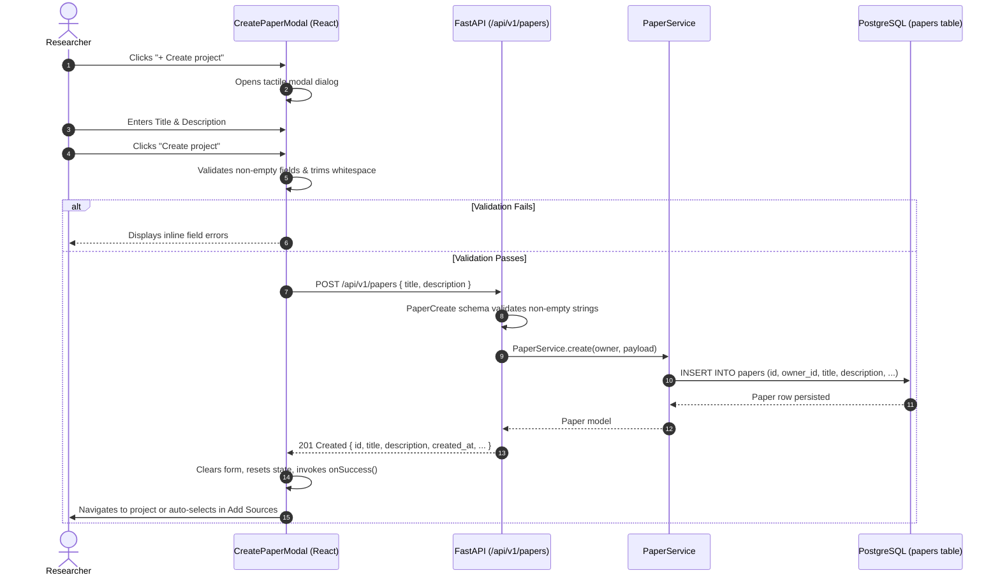

# RESEARCHLENS — PROJECT CREATION WORKFLOW SPECIFICATION
**Component:** `frontend/src/components/papers/CreatePaperModal.jsx`  
**Backend Endpoint:** `POST /api/v1/papers`  
**Database Schema:** `papers` table (`title` VARCHAR(500), `description` TEXT)  

---

## 1. Workflow Architecture & Mandatory Description Validation

Creating a research project now requires both a **Project Title** and a **Project Description**. A research project without a defined topic or purpose compromises the evidence retrieval boundary. Mandatory descriptions are enforced at both frontend and backend layers.



---

## 2. Dialog UX & Tactile Design

- **Dialog Header**:
  - Icon: Folder with plus symbol (`FolderPlus`) in sky accent box.
  - Heading: `"Create a project"`
  - Description: `"Give your research a name and describe what you are studying. You can add documents after creating the project."`
- **Fields**:
  1. **Project Title**:
     - Required field with red asterisk.
     - Placeholder: `e.g. Cybersecurity Research`
     - Auto-focused on modal mount.
     - Live character counter: `{title.length}/500`.
     - Validates against empty strings or whitespace.
  2. **Project Description**:
     - Required field with red asterisk.
     - Multiline textarea (4 rows).
     - Placeholder: `Describe the research topic, its purpose and what you want to explore...`
     - Live character counter: `{description.length}/2000`.
     - Helper text: *"A clear description frames your literature scope and helps organize citations across papers."*
     - Validates against empty strings or whitespace.
- **Elevation & Tactile Surface**:
  - Backdrop blur and subtle dimming.
  - Layered surface shadow: `shadow-[0_24px_64px_-16px_rgba(0,0,0,0.22)]`.
  - Button hover lift and pressed active transitions.
  - Submit button is disabled until both fields have non-whitespace content.
  - Enter key in the form submits if valid; Escape key dismisses cleanly without data loss.

---

## 3. End-to-End Backend Schema & Validation

### Backend Pydantic Schema (`backend/app/schemas/paper.py`):
```python
class PaperCreate(BaseModel):
    title: str = Field(min_length=1, max_length=500)
    description: Optional[str] = Field(default=None, max_length=2000)
    abstract: Optional[str] = None
    ...

    @field_validator("title", mode="before")
    @classmethod
    def validate_title(cls, value: Any) -> str:
        if not isinstance(value, str) or not value.strip():
            raise ValueError("Title is required and cannot be empty or only whitespace.")
        return value.strip()

    @field_validator("description", mode="before")
    @classmethod
    def validate_description(cls, value: Any) -> Optional[str]:
        if value is None:
            return None
        if isinstance(value, str) and not value.strip():
            raise ValueError("Description cannot be empty or only whitespace.")
        return value.strip() if isinstance(value, str) else value

    @model_validator(mode="after")
    def ensure_description_present(self) -> "PaperCreate":
        # New project creation strictly requires a description.
        # Fall back to abstract for legacy tests that populate abstract.
        if not self.description:
            if self.abstract and self.abstract.strip():
                self.description = self.abstract.strip()
            else:
                raise ValueError("Project description is required and cannot be empty.")
        return self
```

### Database Migration:
- Added `description TEXT NULL` column via Alembic revision `b1c2d3e4f5a6_add_paper_description.py`.
- Preserved existing papers with `description = NULL` without fabricating artificial content.

